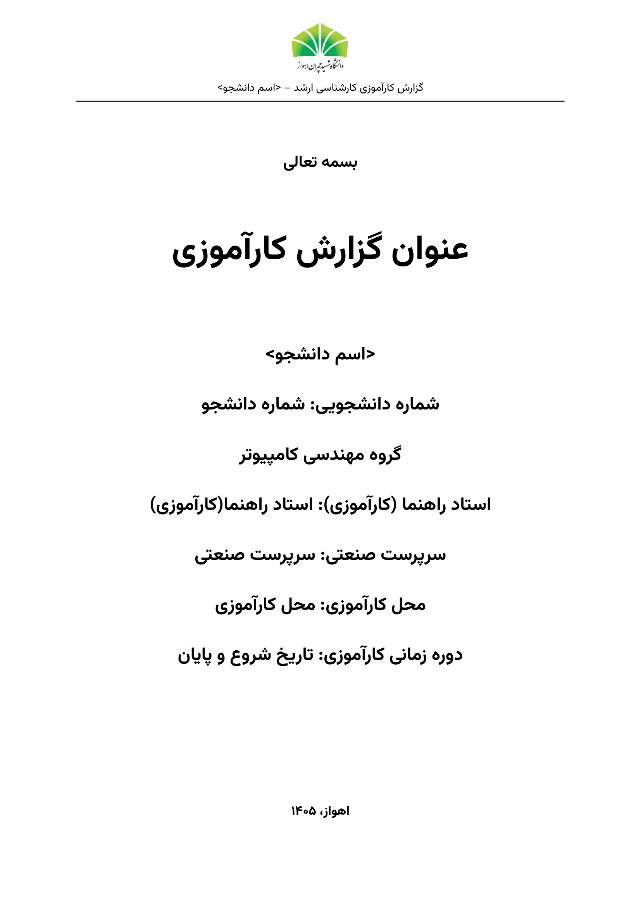
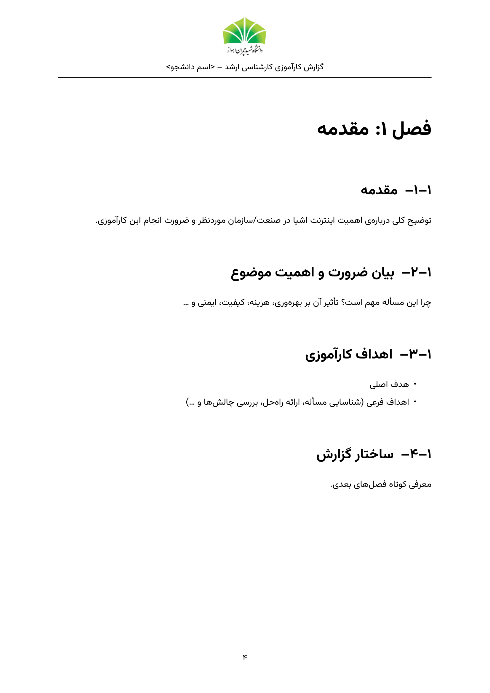
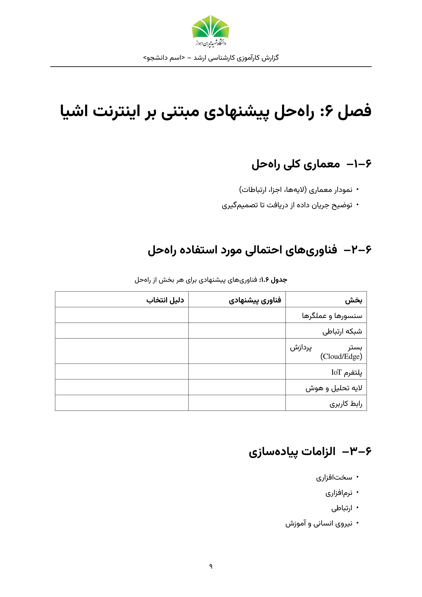

<div align="center">


# قالب LaTeX گزارش کارآموزی کارشناسی ارشد
### دانشگاه شهید چمران اهواز — رشته‌ی مهندسی کامپیوتر

**Chamran  Internship Template** · کلاس `chamranintern`


-2e7d32)


</div>

<div dir="rtl">

## این ریپو چیست؟

یک کلاس آماده‌ی LaTeX برای نوشتن **گزارش کارآموزی دانشجویان کارشناسی ارشد اینترنت اشیا** در دانشگاه شهید چمران اهواز. ساختار فصل‌ها، سرصفحه‌ی لوگودار، صفحه‌ی جلد، چکیده، فهرست‌ها و منابع مطابق قالب رسمی (فایل Word/PDF) طراحی شده است؛ شما فقط اطلاعات خود را وارد و متن فصل‌ها را بنویسید.

| صفحه‌ی جلد | یک فصل نمونه | جدول نمونه |
|:---:|:---:|:---:|
|  |  |  |

خروجی کامل نمونه را در [`main.pdf`](main.pdf) ببینید.

## ویژگی‌ها

- فارسی راست‌به‌چپ با **babel**؛ بدون نیاز به `xepersian` و `bidi`
- سرصفحه با **لوگوی دانشگاه** و نام دانشجو در تمام صفحه‌ها
- شماره‌گذاری فصل و بخش به شکل `۱–۲` مطابق قالب رسمی
- جلد، چکیده با کلیدواژه، فهرست مطالب، فهرست شکل‌ها و جدول‌ها (اختیاری) و منابع
- فونت **وزیرمتن** با ارقام فارسی (داخل ریپو، نیازی به نصب نیست)
- نمونه‌ی کامل هر ۸ فصل کارآموزی با راهنمای نوشتن داخل هر بخش
- ارجاع به منابع با BibTeX (`\cite{...}`)
- کلاس کوچک و خوانا؛ به‌راحتی قابل شخصی‌سازی

## ساختار ریپو

```text
chamran-iot-internship-template/
├── chamranintern.cls      ← کلاس اصلی (این فایل قالب است)
├── main.tex               ← نمونه‌ی گزارش؛ این را ویرایش کنید
├── references.bib         ← منابع شما (BibTeX)
├── logo/chamran-logo.jpg  ← لوگوی دانشگاه
├── fonts/                 ← فونت وزیرمتن + مجوز OFL
├── latexmkrc              ← تنظیم کامپایل خودکار با XeLaTeX
├── main.pdf               ← خروجی نمونه
├── docs/                  ← تصاویر پیش‌نمایش README
└── LICENSE
```

## شروع سریع

### روش ۱: Overleaf (ساده‌ترین، بدون نصب)

1. روی دکمه‌ی **Code ← Download ZIP** همین صفحه‌ی گیت‌هاب کلیک کنید و فایل zip را بگیرید.
2. در [Overleaf](https://www.overleaf.com): **New Project ← Upload Project** و zip را آپلود کنید.
3. از منوی بالا‌چپ (**Menu**) گزینه‌ی **Compiler** را روی **XeLaTeX** بگذارید.
4. اطمینان بگیرید فایل اصلی (Main document) روی `main.tex` است و **Recompile** را بزنید.

### روش ۲: کامپیوتر خودتان

**نیازمندی‌ها:** یک توزیع TeX (نسخه‌ی ۲۰۲۲ یا جدیدتر) شامل XeLaTeX، BibTeX و `latexmk`.

| سیستم‌عامل | نصب |
|---|---|
| Windows | [MiKTeX](https://miktex.org) یا [TeX Live](https://tug.org/texlive/) |
| macOS | [MacTeX](https://tug.org/mactex/) |
| Linux | `sudo apt install texlive-xetex texlive-latex-extra texlive-fonts-recommended latexmk` |

سپس:

```bash
git clone https://github.com/adelsayyahi/Scu-internship-latex-template.git
cd chamran-iot-internship-template
latexmk main          # ساخت main.pdf
```

اگر `latexmk` ندارید:

```bash
xelatex main
bibtex main
xelatex main
xelatex main
```

> در TeXstudio / TeXworks / VS Code (افزونه‌ی LaTeX Workshop) موتور کامپایل را روی **XeLaTeX** بگذارید.

## نوشتن گزارش خودتان

### ۱) اطلاعات جلد

در ابتدای `main.tex` مقادیر را عوض کنید:

```latex
\ReportTitle{عنوان گزارش کارآموزی}
\StudentName{نام و نام خانوادگی دانشجو}
\StudentID{شماره دانشجویی}
\Supervisor{نام استاد راهنما}
\Organization{نام سازمان/صنعت محل کارآموزی}
\InternPeriod{تاریخ شروع و پایان}
\Keywords{اینترنت اشیا، [حوزه صنعتی]، ...}

% اختیاری (با برداشتن % فعال می‌شوند):
% \IndustrySupervisor{نام سرپرست صنعتی}
% \Department{گروه مهندسی کامپیوتر}
% \ReportDate{اهواز، ۱۴۰۵}
```

دستورهای خالی روی جلد چاپ نمی‌شوند.

### ۲) چکیده و فصل‌ها

- چکیده را داخل `\begin{abstract} ... \end{abstract}` بنویسید (کلیدواژه‌ها خودکار زیر آن می‌آید).
- فصل‌ها با `\chapter{...}` و بخش‌ها با `\section{...}` و `\subsection{...}` هستند.
- راهنمای داخل هر بخش را پاک و متن خودتان را جایگزین کنید.
- ساختار پیش‌فرض فصل‌ها:

| فصل | عنوان |
|:---:|---|
| ۱ | مقدمه |
| ۲ | معرفی سازمان/صنعت محل کارآموزی |
| ۳ | مرور پیشینه و فناوری‌های مرتبط با پژوهش |
| ۴ | شرح انجام کارآموزی |
| ۵ | شناسایی و تعریف دقیق مسأله |
| ۶ | راه‌حل پیشنهادی مبتنی بر اینترنت اشیا |
| ۷ | چالش‌ها و محدودیت‌های اجرا |
| ۸ | جمع‌بندی و پیشنهادها |

### ۳) متن لاتین و فهرست‌ها

```latex
فناوری \lat{MQTT} و \lat{LoRaWAN} در لایه‌ی شبکه ...   % کلمه‌ی لاتین داخل متن فارسی
```

برای فهرست شکل‌ها و جدول‌ها، دو خط زیر را در `main.tex` از حالت توضیح (`%`) دربیاورید:

```latex
\listoffigures
\listoftables
```

### ۴) شکل و جدول

```latex
\begin{figure}[h]
  \centering
  \includegraphics[width=0.8\textwidth]{figures/architecture.pdf}
  \caption{معماری کلی راه‌حل}
  \label{fig:arch}
\end{figure}
```

پوشه‌ی `figures/` را خودتان کنار `main.tex` بسازید. نمونه‌ی جدول فارسی در بخش ۶-۲ `main.tex` هست.

### ۵) منابع

1. مرجع را در `references.bib` به‌صورت BibTeX اضافه کنید (از Google Scholar ← Cite ← BibTeX کپی کنید).
2. در متن بنویسید `\cite{atzori2010iot}` یا چند منبع: `\cite{a,b,c}`.
3. دوباره کامپایل کنید (با `latexmk` همه‌ی مراحل خودکار است).

فقط منابعی که با `\cite` آورده شوند در فهرست منابع چاپ می‌شوند.

## گزینه‌ها و تنظیمات

| مورد | چطور |
|---|---|
| سرصفحه بدون لوگو | `\documentclass[nologo]{chamranintern}` |
| تغییر لوگو | فایل `logo/chamran-logo.jpg` را با فایل دیگر هم‌نام جایگزین کنید |
| جابه‌جایی پوشه‌ی فونت | قبل از `\documentclass` بنویسید: `\def\chamranfontpath{مسیر/}` |
| ظاهر خودتان (فونت/حاشیه/فاصله‌ی خط) | بخش‌های `fonts`، `geometry` و `\linespread` در `chamranintern.cls` |

## عیب‌یابی

| مشکل | علت و راه‌حل |
|---|---|
| `Font ... not found` / فونت فارسی نمی‌آید | پوشه‌ی `fonts/` باید کنار `main.tex` باشد؛ یا مسیر را با `\chamranfontpath` بدهید. |
| خطا در Overleaf درباره‌ی موتور | Compiler را روی **XeLaTeX** بگذارید (نه pdfLaTeX). |
| فهرست مطالب یا شماره‌ها خالی/غلط است | برنامه را **دو بار** کامپایل کنید (با `latexmk` خودکار). |
| منابع نشان داده نمی‌شوند | اجرای `bibtex main` و سپس دو بار `xelatex`، و بررسی `\cite{کلید}`. |
| `\headheight is too small` | مقدار `headheight` را در بخش `geometry` کلاس بیشتر کنید. |
| لوگو چاپ نمی‌شود | فایل `logo/chamran-logo.jpg` را بررسی کنید یا از گزینه‌ی `nologo` استفاده کنید. |

## مشارکت

خطا دیدید یا پیشنهاد دارید؟ [Issue](../../issues) باز کنید یا Pull Request بفرستید. به‌خصوص این موارد کمک‌کننده است:

- تطبیق دقیق‌تر با آخرین آیین‌نامه/قالب رسمی دانشکده
- آزمایش روی LuaLaTeX، MiKTeX و Overleaf
- نسخه‌ی برداری (SVG/PDF) رسمی لوگو

## مجوز و حقوق

- کد کلاس و فایل‌های نمونه: **MIT** — [`LICENSE`](LICENSE)
- فونت وزیرمتن: **SIL Open Font License 1.1** — [`fonts/OFL.txt`](fonts/OFL.txt)
- **نام و لوگوی دانشگاه شهید چمران اهواز** متعلق به دانشگاه است و مشمول مجوز MIT نیست؛ فقط برای تهیه‌ی گزارش‌های دانشگاهی استفاده شود.
- این پروژه رسمی نیست و از طرف دانشگاه منتشر نشده است؛ پیش از تحویل، رعایت آخرین دستورالعمل کارآموزی دانشکده را بررسی کنید.

</div>

---

<details>
<summary><b>English summary</b></summary>

**Chamran IoT Internship Template** is a LaTeX class (`chamranintern`) for MSc Internet-of-Things internship reports at Shahid Chamran University of Ahvaz (Iran). It provides a Persian (RTL) report layout with the university logo in the header, a cover page, abstract, table of contents, eight pre-structured chapters and BibTeX references.

**Quick start**

```bash
git clone https://github.com/<USERNAME>/chamran-iot-internship-template.git
cd chamran-iot-internship-template
latexmk main        # requires XeLaTeX (TeX Live 2022+), BibTeX, latexmk
```

On Overleaf: upload the ZIP, set **Compiler = XeLaTeX**, main document `main.tex`.

Edit the cover metadata at the top of `main.tex` (`\ReportTitle`, `\StudentName`, `\StudentID`, `\Supervisor`, `\Organization`, `\InternPeriod`, `\Keywords`) and replace the placeholder text of each chapter. Use `\lat{...}` for Latin words inside Persian text and `\cite{key}` with `references.bib` for citations. Options: `\documentclass[nologo]{chamranintern}`.

**Status:** XeLaTeX tested; LuaLaTeX untested; pdfLaTeX unsupported.
**License:** MIT (code), SIL OFL 1.1 (Vazirmatn fonts). The university name and logo are property of the university and not covered by the MIT license.
**Author:** A'adel sayyahi

</details>
